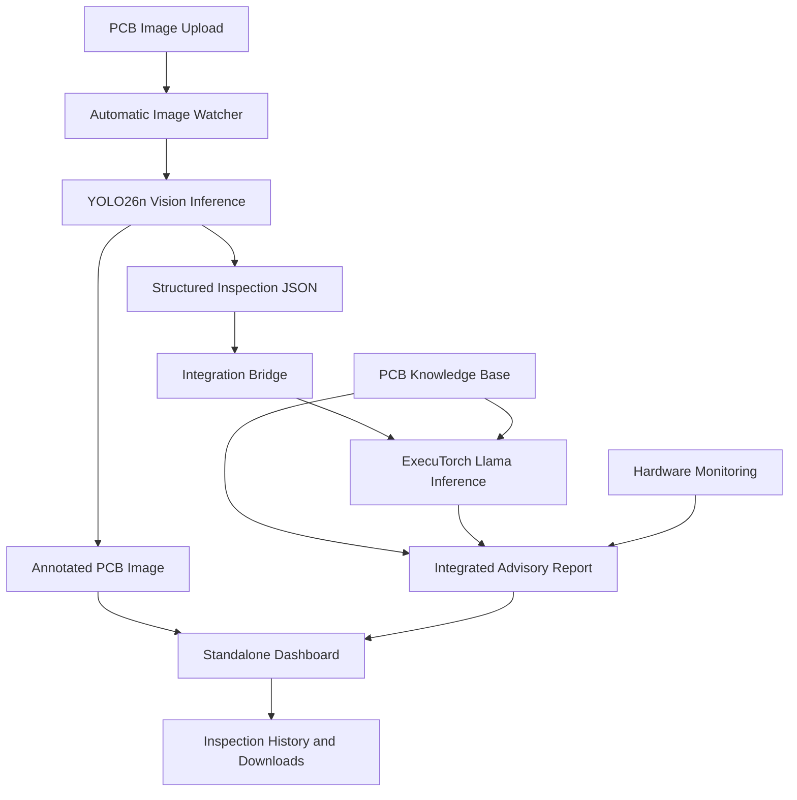

# Intelligent PCB Inspection Using Edge AI on Arm

Arm Bharat AI-SoC Challenge - 2nd Edition

## Overview

An offline intelligent PCB defect detection and
advisory system developed on Raspberry Pi 5.

The system combines YOLO26n for PCB defect detection
with a fine-tuned Llama 3.2 1B model running through
ExecuTorch for defect-specific corrective-action
selection.

All production inference, inspection processing,
hardware monitoring and reporting operate locally
on the Arm-based device.

## Objectives

- Automate PCB defect detection.
- Identify and localize manufacturing defects.
- Provide defect-specific corrective recommendations.
- Enable offline AI inference on Arm hardware.
- Monitor system performance and hardware utilization.
- Provide a standalone inspection application.

## Hardware Platform

- Raspberry Pi 5
- 8 GB RAM
- Broadcom BCM2712 SoC
- Quad-core Arm Cortex-A76 CPU
- AArch64 architecture
- CPU-only inference
- Raspberry Pi OS
- Local microSD storage

## Technologies Used

- YOLO26n
- PyTorch
- Llama 3.2 1B Instruct
- QLoRA
- ExecuTorch
- XNNPACK
- KleidiAI-enabled runtime build
- Python
- OpenCV
- Gradio
- SQLite
- JSON
- Linux systemd

## Dataset

The vision model was developed using the DsPCBSD+
industrial PCB defect dataset.

## Supported Defect Classes

| Class | Defect |
|---|---|
| SH | Short Circuit |
| SP | Spur |
| SC | Spurious Copper |
| OP | Open Circuit |
| MB | Mouse Bite |
| HB | Hole Breakout |
| CS | Conductor Scratch |
| CFO | Conductor Foreign Object |
| BMFO | Base Material Foreign Object |

## System Architecture

## Application Features

- Automatic PCB image inspection
- Nine-class defect detection
- Defect localization
- Confidence score visualization
- Annotated PCB images
- Structured inspection records
- Local ExecuTorch inference
- Defect-specific corrective-action selection
- Advisory validation and fallback
- Inspection history
- Recoverable record archival
- JSON report downloads
- Hardware utilization monitoring
- Performance monitoring
- Automatic system startup
- Standalone graphical interface
- Offline operation

## Vision Module

YOLO26n performs PCB defect detection and
localization using the trained vision model.

The detected defects are converted into structured
JSON records for downstream advisory processing.

The vision model remains loaded for subsequent
inspections.

## Advisory Module

A PCB-specific fine-tuned Llama 3.2 1B model
operates through the ExecuTorch runtime.

The production system uses constrained corrective
action selection supported by a structured PCB
knowledge base.

Detailed causes, potential impacts and corrective
actions are obtained from the knowledge base.

Invalid model selections trigger an identified
knowledge base fallback.

## Hardware Monitoring

The application monitors:

- CPU temperature
- System RAM utilization
- Available memory
- Monitored PMIC rail power
- Estimated energy consumption
- YOLO inference latency
- Complete vision processing latency
- Llama inference latency
- Advisory processing latency
- Integrated processing latency
- Effective inspection rate

Power measurements represent monitored PMIC rails
rather than total device input power.

## Performance Evaluation

Updated benchmark results will be published
following the final evaluation.

## Repository Structure

| Directory | Purpose |
|---|---|
| vision | Vision inference and automatic inspection |
| advisory | ExecuTorch inference server |
| integration | Vision and advisory integration |
| dashboard | Graphical application |
| config | Knowledge base and class mapping |
| hardware_monitoring | Hardware and performance monitoring |
| deployment | Services and application launcher |
| requirements | Software dependencies |
| models | Model documentation and checksums |
| benchmarks | Benchmark scripts |
| results | Curated inspection evidence |
| docs | Technical documentation |

## Deployment

See [Deployment documentation](docs/DEPLOYMENT.md).

See [Model documentation](models/README.md).

## Offline Operation

After installation, normal inspection processing
does not require internet connectivity.

The application uses local services for vision
inference, advisory processing, hardware monitoring
and graphical visualization.

## Limitations

- The current implementation uses uploaded PCB images.
- Live camera operation has not been validated.
- Llama selects corrective actions rather than
  independently generating every advisory field.
- Engineering advisory accuracy requires independent
  validation.
- Defect severity requires further assessment.
- PMIC rail measurements do not represent total
  device input power.

## Project Status

The application is operational on Raspberry Pi 5.

Training artifacts, model access arrangements and
final evaluation results are being collected.

<!-- FINAL_BENCHMARK_START -->

## Final On-Device Demonstration Results

| Metric | Measured result |
|---|---:|
| Selected test images | 4 |
| Total detected defects | 11 |
| Mean YOLO inference FPS | 2.377 |
| Mean complete processing time | 23.708 s |
| Validated Llama selections | 7 |
| Knowledge base fallbacks | 4 |
| Completed hardware measurements | 4/4 |

These are fresh demonstration results from the deployed
Raspberry Pi 5 system, not independent accuracy scores.

FPS represents reciprocal latency rather than sustained
throughput. Power measurements cover monitored PMIC rails,
not total device input power.

See [Final Inspection Results](results/README.md)
for original images, annotated images, structured records,
hardware measurements, logs and evidence manifests.

See [YOLO26n Training](training/vision/README.md)
for the original training notebook and dataset configuration.

<!-- FINAL_BENCHMARK_END -->

## Final Project Report

[Final Project Report](docs/Intelligent_PCB_Defect_Detection_and_Advisory_System_Final_Report.pdf)
